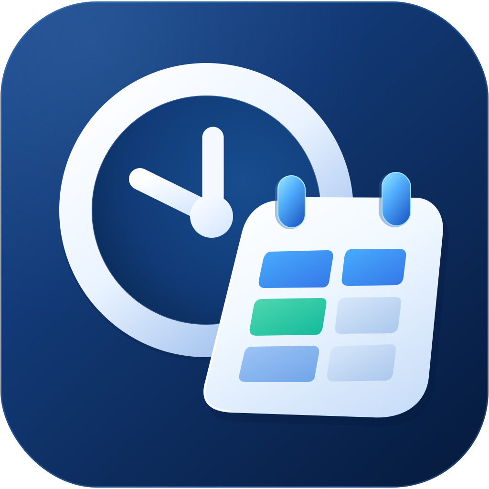
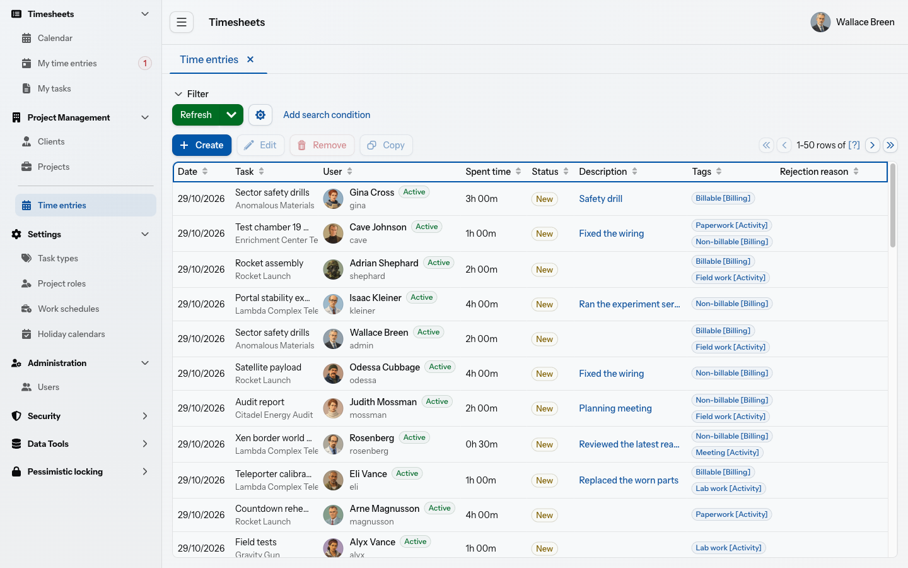
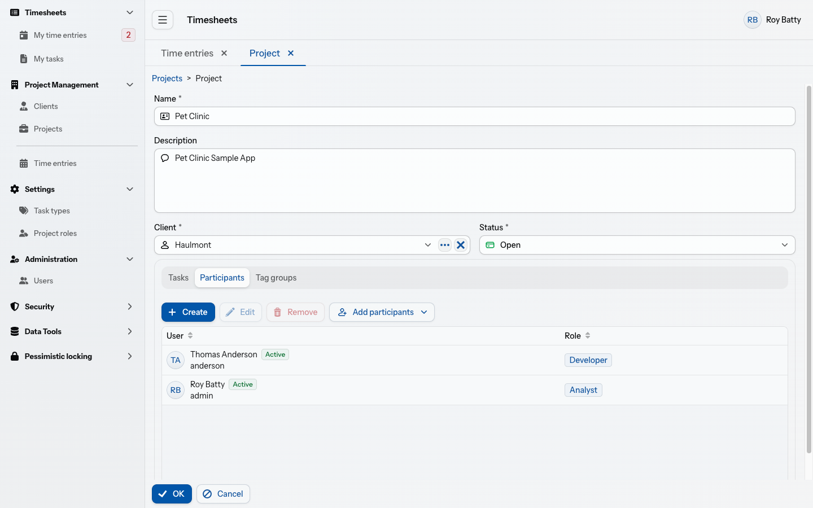
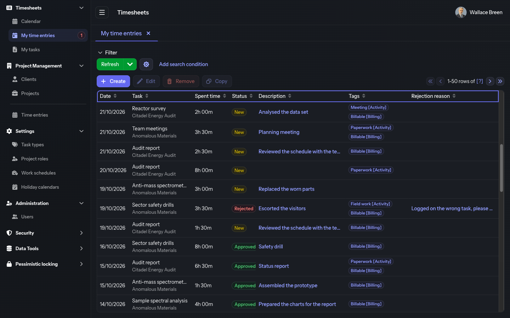

<p align="center">
  
</p>

<h1 align="center">Timesheets</h1>

<p align="center">
  <a href="https://github.com/glebfox/timesheets/actions/workflows/tests.yml"></a>
  <a href="LICENSE"></a>
  <a href="https://www.jmix.io/"></a>
</p>

<p align="center">A time tracking application: log the hours you spend on project tasks and get them reviewed.</p>



> The project is in active development, so the screenshots may lag behind the current UI.

## Features

- **Time logging** — log time against the tasks you can book: active tasks of open projects you take part in. Type durations the way you think of them: `4:30`, `90`, or `4h 30m`.
- **Calendar** — your month at a glance: entries by day with daily, weekly, and monthly totals against your work schedule, with holidays and moved days named on their days; create, copy, or drag an entry to another day right there.
- **Work schedules** — how long a workday is and which days of the week are worked, optionally with a holiday calendar of public holidays and moved days that several schedules can share. A user is assigned a schedule from a date, and the default schedule covers the days no assignment does.
- **Review** — every entry is New, Approved, Rejected, or Closed. A rejected entry carries the reason, and its owner sees the number of rejected entries in the menu, updated live.
- **Projects** — a project belongs to a client and owns its tasks, its participants with their project roles, and its tag groups.
- **Tags** — time entries are tagged from the tag groups of their project, and a task can make some groups required.
- **Clients** — client cards with a logo and contact details.
- **Users and access** — users with avatars and time zones, access through Jmix security roles, and user substitution.
- **Interface** — a tabbed workspace, light and dark themes, English and Russian.

<table>
  <tr>
    <td width="50%"></td>
    <td width="50%"></td>
  </tr>
  <tr>
    <td align="center">A project with its participants</td>
    <td align="center">My time entries in the dark theme</td>
  </tr>
</table>

## Tech stack

[Jmix](https://www.jmix.io/) on Spring Boot with a Vaadin Flow UI and the Aura theme; PostgreSQL with a Liquibase-managed schema. The entities and their relations are diagrammed in [the data model overview](docs/specs/data-model/README.md).

## Getting started

You need:

- JDK 21.
- PostgreSQL with a database `ts` on `localhost`, reachable as `root`/`root`; the connection is set in `src/main/resources/application.properties`.
- Credentials for the Jmix premium repository, which serves the Tabbed Application Mode add-on. Pass them as the Gradle properties `premiumRepoUser` and `premiumRepoPass` (for example in `~/.gradle/gradle.properties`) or as the environment variables `PREMIUM_REPO_USER` and `PREMIUM_REPO_PASS`.

Run the application with demo data:

```bash
SPRING_PROFILES_ACTIVE=dev ./gradlew bootRun
```

Open http://localhost:8080; the login form is pre-filled with `admin`/`admin`. With the `dev` profile, an empty database gets demo data: people and organizations of the Half-Life and Portal games, with time logged over the weeks up to today; every demo user's password is their username. Without it, only the schema and the `admin` user are created.

Run the tests, which use an in-memory HSQLDB:

```bash
SPRING_PROFILES_ACTIVE=test ./gradlew test
```

## Contributing

Every source file starts with the Apache License header, and CI fails on a file without one. Add the header to new files with:

```bash
./gradlew spotlessApply
```

[ARCHITECTURE.md](ARCHITECTURE.md) shows where things live, and [docs/](docs/) holds the specs of the entities, roles, and screens.

## License

Copyright 2023-2026 Gleb Gorelov. Licensed under the [Apache License, Version 2.0](LICENSE). Third-party assets and their licenses are listed in [NOTICE](NOTICE).
