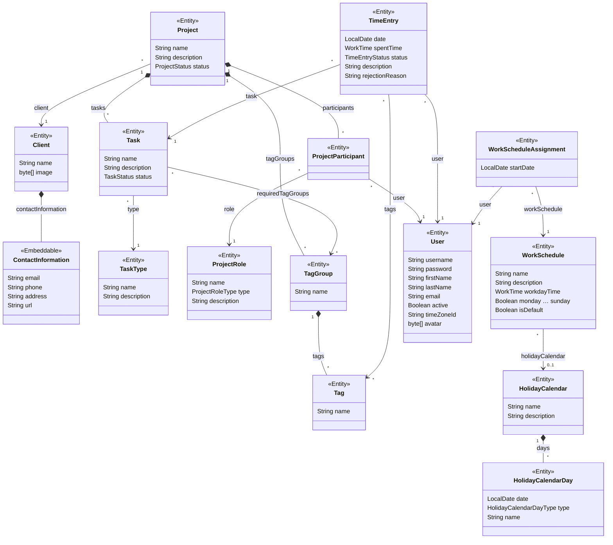

# Data model

Source: `entity/`, `datatype/`

The entities at a glance; each has its own spec in this directory.

A filled diamond marks an owner and its parts. Every entity also has a UUID `id` and a `version` for optimistic locking, and every entity so far has the soft-delete attributes `deletedBy` and `deletedDate`; the diagram leaves them out.

- A [project](project.md) owns its [tasks](task.md), [participants](project-participant.md), and [tag groups](tag-group.md), and a tag group owns its tags: they are edited inside their owner and deleted with it.
- A [time entry](time-entry.md) is one user's time on one task and may carry tags; the editor offers those of the task's project. Its duration is a [work time](work-time.md) value.
- A [work schedule](work-schedule.md) plans how long each workday is and which days of the week are workdays; a [holiday calendar](holiday-calendar.md) it uses overrides the week on dated days. [Assignments](work-schedule-assignment.md) tie a user to a schedule from a date; exactly one schedule is the default, for the days no assignment covers. A user's plan for a day comes from them.
- A holiday calendar owns its days and edits them inside itself, but a deleted calendar keeps them, so the schedules that still use it plan as before.
- [Clients](client.md), [task types](task-type.md), [project roles](project-role.md), [users](user.md), work schedules, and holiday calendars stand on their own: deleting one leaves whatever refers to it in place, except that a user's work schedule assignments are deleted with the user.

## Rules that hold for every entity

- Every entity so far is soft-deleted: deleting marks a row instead of removing it, and uniqueness holds among non-deleted rows only (`docs/guidelines/database.md`). Soft deletion is chosen per entity, not required of every one (`docs/conventions.md`).
- An entity enforces its required attributes, its value ranges, and database uniqueness on every save, and deletes what its deletion takes with it, such as a project's tasks or a user's work schedule assignments, on every delete. Each spec says which of its other rules also hold on every save, such as the one default work schedule, and which are applied only by the editors, such as which tasks are bookable or when a rejection reason is required; a save through `DataManager` bypasses the latter.
