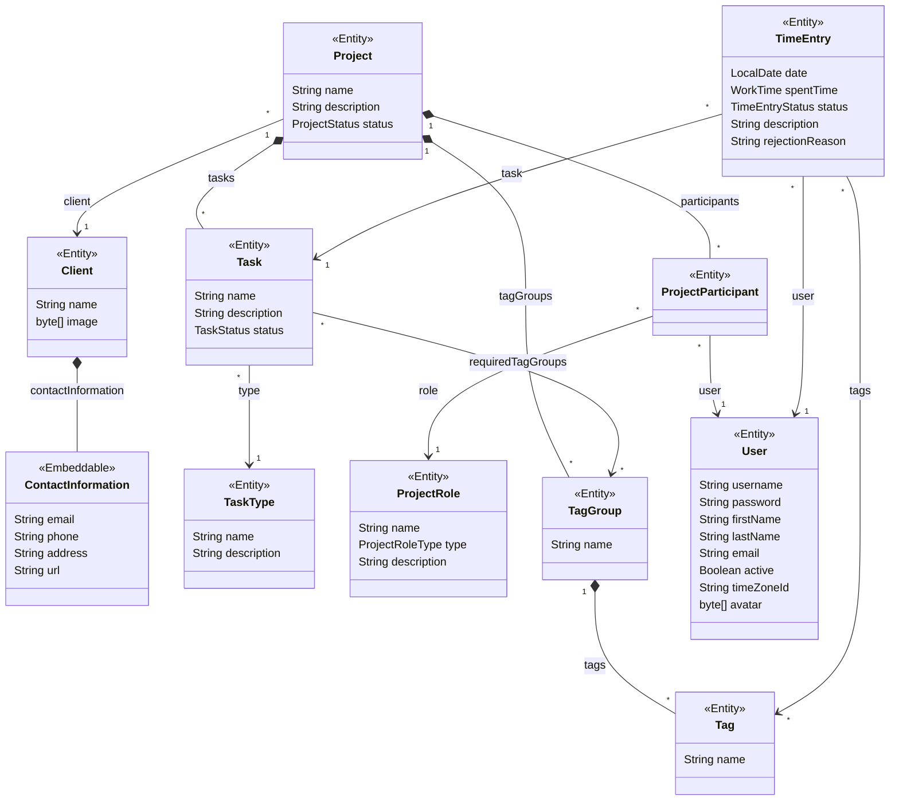

# Data model

Source: `entity/`, `datatype/`

The entities at a glance; each has its own spec in this directory.

A filled diamond marks an owner and its parts. Every entity also has a UUID `id`, a `version` for optimistic locking, and the soft-delete attributes `deletedBy` and `deletedDate`; the diagram leaves them out.

- A [project](project.md) owns its [tasks](task.md), [participants](project-participant.md), and [tag groups](tag-group.md), and a tag group owns its tags: they are edited inside their owner and deleted with it.
- A [time entry](time-entry.md) is one user's time on one task and may carry tags; the editor offers those of the task's project. Its duration is a [work time](work-time.md) value.
- [Clients](client.md), [task types](task-type.md), [project roles](project-role.md), and [users](user.md) stand on their own: deleting one leaves whatever refers to it in place.

## Rules that hold for every entity

- Every entity is soft-deleted: deleting marks a row instead of removing it, and name uniqueness holds among non-deleted rows only (`docs/guidelines/database.md`).
- An entity enforces only its required attributes, its value ranges, and database uniqueness. The other rules in these specs, such as which tasks are bookable or when a rejection reason is required, are applied by the editors; a save through `DataManager` bypasses them. Each spec says which of its rules are applied this way.
