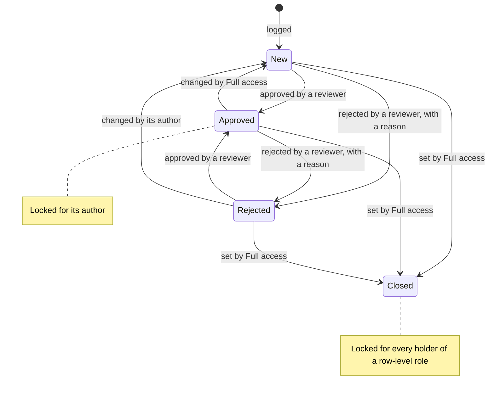

# Time entry

Source: `entity/timeentry/`, `app/TimeEntrySupport.java`, `app/TimeEntryApprovalSupport.java`, `app/TimeEntryAccessSupport.java`, `listener/TimeEntryEventListener.java`, `event/TimeEntryStatusChangedEvent.java`

One user's time spent on one task on one day. Any number of entries may share a user, task, and date.

## Attributes

- **Date, user, task, spent time** — required. Spent time is a [work time](work-time.md) value.
- **Description** — optional, in Markdown.
- **Tags** — any number of [tags](tag-group.md).
- **Status** — New, Approved, Rejected, or Closed; every new entry starts as New.
- **Rejection reason** — Markdown text that explains a rejection, written when the [approval screen](../views/approval.md#rejecting) rejects the entry; the time entry editor shows it and does not edit it, so an entry set to Rejected there has none. It is kept when the status later changes, back to New included.
- Shown as `<date> [<project>] <task>`.

## Status

A reviewer is someone the approval rule lets review the entry: a Manager of its project, or an Approver of it when the author is someone else and not one of its Managers ([approval](../views/approval.md#which-entries-it-shows)). The author changes or removes their entry while it is New or Rejected, and a change to what a Rejected entry says sends it back to New. An Approved entry is locked for its author, a Manager reviewing their own entries included: only a rejection opens it again ([decision 0025](../../decisions/0025-an-approved-time-entry-is-locked-for-its-author.md)). A Closed entry, whose time has been paid for, is locked for everyone who holds a row-level role. These locks and moves hold, on every save, for the holders of [Time entry rules](../roles/time-entry-rules.md) and of the row-level roles that include it, every job role's row-level role among them. [Full access](../roles/system-full-access.md) holds no row-level role, so the Administrator sets any status by hand in the editor, Closed included, and changes an entry in any status. No screen closes entries otherwise ([#117](https://github.com/glebfox/timesheets/issues/117)).

Three things change a status:

- The editor: a user whose roles let them change an entry's status, such as Full access or [Time entries: approval](../roles/time-entry-approval.md), can set any status there, and the editor forbids no transition. For a holder of Time entry rules, the editor opens an entry read-only unless it is their own and New or Rejected, and a status they set there is saved only as that role allows: New on their changed Rejected entry, or Approved or Rejected where the approval rule lets them review the entry.
- The [approval screen](../views/approval.md): a Manager or Approver of the entry's project, by the rule that decides whose entries they approve, sets a New or Rejected entry to Approved, and a New or Approved entry to Rejected with a reason, which replaces the reason of an earlier rejection that an Approved entry may still carry. An approved entry keeps its rejection reason, and a Rejected entry is not rejected again. The screen never sets New or Closed and never changes a Closed entry.
- A change to what a reviewed entry says: when a save of an existing Approved or Rejected entry changes its date, user, task, spent time, description, or tags, the entry is saved as New, so that it is reviewed again ([decision 0012](../../decisions/0012-a-changed-approved-or-rejected-time-entry-goes-back-to-new-on-every-save.md)). The rule holds on every save, whatever screen or `DataManager` call makes it, the calendar's move to another day included, and whatever the saving user may read. A save that also sets a status other than the stored one keeps that status, so a status chosen in the editor together with an edit stands. A blank description counts as none, and the tags count as a set without deleted tags, so their order and a tag deleted meanwhile are no change. Changing only the rejection reason, or nothing, leaves the status alone, as does any change to a New or Closed entry and a save of an entry loaded without its status. A new entry keeps the status it is created with.

None of them records who changed the status, or when ([decision 0009](../../decisions/0009-who-approved-or-rejected-an-entry-is-left-to-the-audit-add-on.md)).

Apart from the approval screen, the dashboard's team blocks, the locks, and the rule above, Rejected is the only status with behavior attached: the entry's user sees their count of Rejected entries in the main menu ([main view](../views/main.md)) and in the dashboard's Needs attention ([dashboard](../views/dashboard.md#needs-attention)), and the editor and the lists show the rejection reason ([time entries](../views/time-entries.md)).

After an entry is created or deleted, or its status changes, whatever saves it, the rule above included, the open sessions of the entry's user are told to refresh that count, whether or not that user is deleted. A change that moves an entry to another user tells only the new user, and only if the status changed too.

## Rules applied when editing

These rules are applied by the time-entry editor, not on save; a save through `DataManager` skips them.

- The task must be [bookable](task.md#bookable-tasks) for the entry's user.
- Tags come from the tag groups of the task's project. Each of the task's required tag groups must contribute at least one tag; the other groups are optional. When an existing entry is moved to a task of another project, its saved tags from the old project stay unless the user removes them.

## Copying

A copy is a new entry with the source's date, user, task, spent time, description, and tags, the status New, and no rejection reason.

## Deletion

Deleting an entry soft-deletes it. **Known defect:** it also deletes every tag attached to the entry, so the tag disappears from its tag group and from every other entry that carries it. Confirmed with a throwaway test on 2026-10-16; tracked in [#8](https://github.com/glebfox/timesheets/issues/8).

## Not covered

- The locks and the moves between statuses under the time entry rules: checked through a constrained `DataManager` save and the approval operations ([Time entry rules](../roles/time-entry-rules.md#not-covered)). Full access setting Closed by hand in the editor: no test.
- The editing rules above: no test checks them. `TimeEntryDetailViewUiTest` opens the editor only for the rejection notice, the tag fields' read-only mode, and saving a Rejected entry.
- Who is told when an entry is created, when a change moves it to another user, and when a change leaves its status alone: the tests check an entry of a deleted user, when it is deleted or its status changes, that the approval operations tell the user of a live entry whose status they change, and that a change that sends a Rejected entry back to New tells its user; `DemoDataLoaderTest` checks that each entry the demo data creates tells someone once, but not whom.
- The rejected count refreshing in the open sessions that are told: it needs a live session (`docs/guidelines/testing.md`). Seen live on 2026-11-03 in the session that made the change only: the count dropped after a Rejected entry was changed in the editor and after one was moved on the calendar.
- A save of an entry loaded without its status, which the rule leaves alone: no test, and no save path of the application loads an entry so. `TimeEntryStatusResetTest` covers the rest of the rule, a load without the references included.
- The tag deletion defect: no test in the suite.
