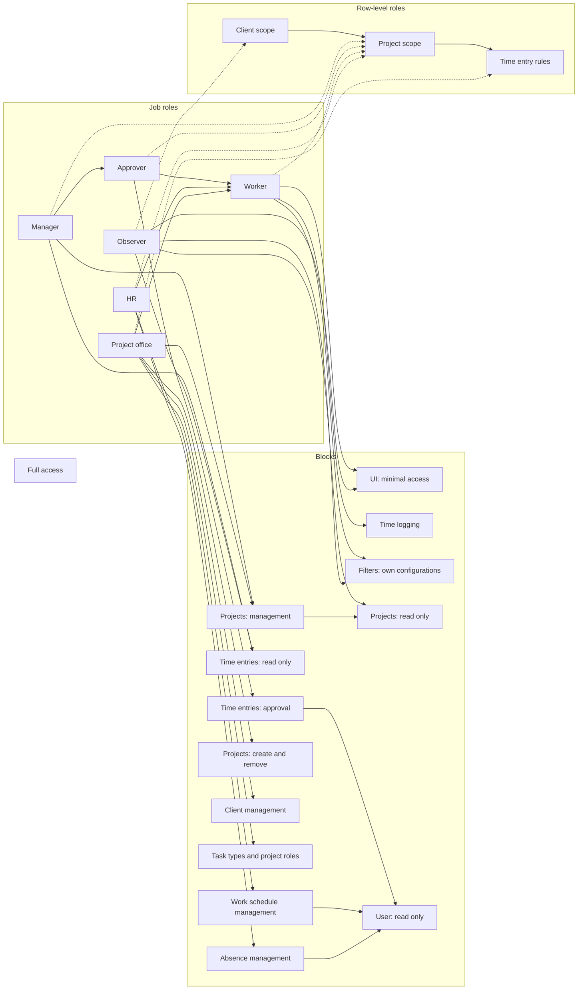

# Security roles

Source: `security/`

Access control is Jmix security roles only. The code defines twenty resource roles and three row-level roles, each with its own spec here ([every role](#every-role)). Further roles of either kind can be created at runtime in the Security screens and assigned to users with Role assignments ([users](../views/users.md)). A user's roles are role assignments, not attributes of the user ([user](../data-model/user.md#access)).

## Two axes

A person's job role, a resource role, says what kind of work they do and which screens they have. Their [project role](../data-model/project-role.md), set per project on its Participants tab ([project participant](../data-model/project-participant.md)), says where. The row-level role [Project scope](project-scope.md) checks the project role on each project, so a person does something on a project only when both allow it: the Manager of one project who is a Member of another runs the first and sees all the time logged there, but on the second logs and sees only their own. Why one row-level role does it: [decision 0023](../../decisions/0023-project-roles-narrow-job-roles-through-one-row-level-role.md).

A job role is composed of granular blocks, each named by what it grants (`docs/conventions.md`), and is named by the kind of work its holder does. A person may hold several job roles and gets what any of them grants. Full access stands apart: it grants everything and is held by the Administrator.

Project roles and their types (Manager, Approver, Member, Observer) are project data, not security roles, and grant no permission of their own. They decide whose time entries a user approves on a project ([approval](../views/approval.md#which-entries-it-shows)), whom the [dashboard](../views/dashboard.md#my-team)'s My team shows that user, and which projects' tasks are offered to the user for logging time ([bookable tasks](../data-model/task.md#bookable-tasks)); for a holder of Project scope or [Client scope](client-scope.md), they also narrow what the user's security roles grant to the projects where the user takes part.

## The roles at a glance

A solid arrow points from a role to a role it includes. A dotted arrow points from a job role to the row-level role a person who holds that job role alone gets; for a person who holds several, the [table below](#job-roles-and-their-row-level-role) gives it. Full access includes nothing and gets no row-level role.

## Job roles and their row-level role

Row-level roles do not add up as resource roles do, they narrow one another, so each combination of job roles gets one row-level role, which the Administrator assigns as a second assignment beside the job roles:

| Job roles held | Row-level role |
|---|---|
| Full access, with anything | none |
| Project office, with anything but Full access | [Time entry rules](time-entry-rules.md): Project office keeps every project, also when it approves or manages |
| Observer alone | [Client scope](client-scope.md) |
| Worker, Approver, Manager, or HR, with or without Observer | [Project scope](project-scope.md) |

Nothing assigns the row-level role by itself, and nothing checks it: a person given a job role without the row-level role, or with the wrong one, is unrestricted, or narrowed wrongly, and no screen shows it. A Manager without Project scope reads and changes every project and every time entry, Closed ones included. Why two assignments, failing open: [decision 0026](../../decisions/0026-a-persons-row-level-role-is-a-second-assignment-and-a-missing-one-fails-open.md).

## Who can do what

Each job role held with the row-level role of the table above; the Administrator holds Full access. In the cells, "own" means only the person's own; "their" means the projects where the person takes part, changed only where they are the project's Manager, and "their, read" read only there; of time entries, "their" means the entries of the projects where the person is a Manager, an Approver, or an Observer; of approving, the entries the approval rule lets the person review ([approval](../views/approval.md#which-entries-it-shows)); "all" means every project or record.

| Screen or action | Worker | Approver | Manager | Observer | HR | Project office | Administrator |
|---|---|---|---|---|---|---|---|
| Dashboard: My time | own | own | own | — | own | own | own |
| Calendar, My time entries, My tasks | own | own | own | — | own | own | own |
| Log, change, and remove time (New or Rejected) | own | own | own | — | own | own | anyone's, in any status |
| Clients | — | — | picker, read¹ | — | — | all | all |
| Projects: list and editor | — | — | their | their, read | — | all | all |
| Create and remove projects | — | — | — | — | — | all | all |
| Tasks, participants, tag groups, and tags | — | — | their | their, read | — | all | all |
| Time entries: everyone's, read only | —² | —² | their, read | their, read | —² | —² | all |
| Approve and reject; the dashboard's My team | — | their | their | — | — | — | their |
| Task types, project roles | — | — | picker, read¹ | — | — | all | all |
| Work schedules, holiday calendars, absence types, absences | — | — | — | — | all | — | all |
| Users | — | read | read | — | read, work schedule assignments changed | picker, read¹ | all: only the Administrator creates and changes users |
| Role assignments, resource and row-level roles, Entity inspector, locks | — | — | — | — | — | — | all |
| Set a status by hand, change a Closed entry | — | —³ | —³ | — | — | — | all |
| Own filter configurations | own | own | own | own | own | own | all |

1. The list is the picker of an editor's field: for a Manager, the project editor's client, the task editor's type, and the participant editor's role; for Project office, the participant editor's user and Add participants. It has no menu item, and tabbed mode also opens it by its URL; it stays read only, and its Edit, labeled Read, ends in the framework's access-denied message, as the job role does not grant the editor ([Projects: management](project-management.md#grants), [Project office](project-office.md#grants)).
2. They have no Time entries list, and no screen lists other people's entries to them apart from an Approver's approval screen, which lists those the approval rule lets them review; but [Time logging](time-logging.md#grants) opens the time entry editor by its URL, `time-entries/:id`, on any entry the person's row-level role lets them read, read only: under Project scope, the entries of the projects where they are a Manager, an Approver, or an Observer; for Project office, whose row-level role narrows no reading, every entry ([Project office](project-office.md#row-level-role)).
3. On their own New or Rejected entry, the time entry editor's Status field is editable for an Approver or a Manager ([#105](https://github.com/glebfox/timesheets/issues/105)), and the time entry rules judge the save by the person's project role on the entry's project: where they are its Manager, they set Approved or Rejected there, as the approval rule lets a project's Manager review their own entries; elsewhere a change of the status alone is refused, whichever of the two job roles they hold ([Approver](approver.md#grants), [Manager](manager.md#grants)).

## Project roles on a project

What a project role unlocks for a holder of Project scope, on that project, and the job role that has the screens to act on it:

| Project role | What it unlocks there | Job role it needs |
|---|---|---|
| Member | Its active tasks are offered for logging time; the person logs and sees their own time there | Worker |
| Observer | The project read only, with its tasks, participants, tag groups, and tags, and all the time logged on it, in every status, rejection reasons included. Its tasks are not offered for logging time, the person creates no time entry on it, and they are on no one's My team through it | Observer |
| Approver | What a Member gets, plus reviewing the time of the project's participants but their own and the Managers' (the approval rule); the project read only, and all its time | Approver |
| Manager | What an Approver gets, plus reviewing all the project's time, their own included, and changing the project, its tasks, participants, tag groups, and tags | Approver to review, Manager to change the project |

A project role above the person's job role is not checked: what it unlocks reaches the person through the screens their job roles open, and no further. A Worker who is a project's Manager reads all its time, in the time entry editor opened by its URL, but has no screen to review it or to change the project; an Approver who is a project's Manager reviews its time on the approval screen as its Manager, their own entries included, but changes nothing of the project. Project office and the Administrator read and change every project, whatever their project role there; still, a holder of Project office logs time only on the projects where they take part in a role other than Observer.

## Every role

[Full access](system-full-access.md) grants everything: it is the Administrator's role, held alone.

### Blocks

- [UI: minimal access](ui-minimal.md) — signing in and the main view, nothing else.
- [User: read only](user-read-only.md) — reading users in the user list and the user editor.
- [Work schedule management](work-schedule-management.md) — work schedules, holiday calendars, and who works to which schedule from which date; it includes User: read only.
- [Absence management](absence-management.md) — absences and absence types; it includes User: read only.
- [Time logging](time-logging.md) — logging one's own time: the calendar, My time entries, My tasks, and the time entry editor; creating, changing, and removing time entries, whose user, status, and rejection reason stay view-only; and reading what these screens show.
- [Time entries: approval](time-entry-approval.md) — the approval screen and changing the status and rejection reason of time entries; it includes User: read only.
- [Time entries: read only](time-entry-read.md) — the Time entries list and the time entry editor, read only, with what they show of an entry.
- [Projects: read only](project-read.md) — the project list and the project editor with its dialogs, read only, with what they show: participants and their project roles, tasks and their types, tag groups, tags, and the project's client.
- [Projects: management](project-management.md) — changing projects, and creating, changing, and removing their tasks, participants, tag groups, and tags, with the lists the editors' fields pick from, not creating or removing projects; it includes Projects: read only.
- [Projects: create and remove](project-creation.md) — creating and removing projects, with no screen of its own.
- [Client management](client-management.md) — the client list and the client editor.
- [Task types and project roles](project-catalogs.md) — the task type and project role lists and editors.
- [Filters: own configurations](own-filters.md) — adding conditions to a list's filter and saving one's own filter configurations, not configurations for everybody and not JPQL conditions.

### Job roles

- [Worker](worker.md) — UI: minimal access, Time logging, and Filters: own configurations.
- [Approver](approver.md) — Worker and Time entries: approval.
- [Manager](manager.md) — Approver, Projects: management, and Time entries: read only.
- [Observer](observer.md) — UI: minimal access, Projects: read only, Time entries: read only, and Filters: own configurations.
- [HR](hr.md) — Worker, Work schedule management, and Absence management.
- [Project office](project-office.md) — Worker, Client management, Projects: create and remove, Projects: management, and Task types and project roles.

### Row-level roles

- [Time entry rules](time-entry-rules.md) — the write rules of time entries: who creates, changes, and removes an entry, in which status, and which of its attributes.
- [Project scope](project-scope.md) — narrows project data and time entries to the projects where the person takes part, and lets them change project data only where they are the project's Manager; it includes Time entry rules.
- [Client scope](client-scope.md) — for a project's client: Project scope, and users and clients narrowed to those of the projects where the person takes part.

## Not covered

- The who-can-do-what table: the menu items each job role opens, held with the row-level role of the combination table, and whether it logs time, are checked by `JobRolesTest`; the other cells by the tests each role's spec names. Footnote 2 was seen once, for Project office only, and footnote 3 once, each in a UI test written to look and not kept ([Project office](project-office.md#not-covered), [Approver](approver.md#not-covered), [Manager](manager.md#not-covered)); no test opens another person's entry by its URL as a Worker, an Approver, or HR, and none saves a status as an Approver who is the Manager of the entry's project.
- A person holding several job roles: only Project office with Approver, under Time entry rules, is checked (`JobRolesTest`); no test checks what another combination opens.
